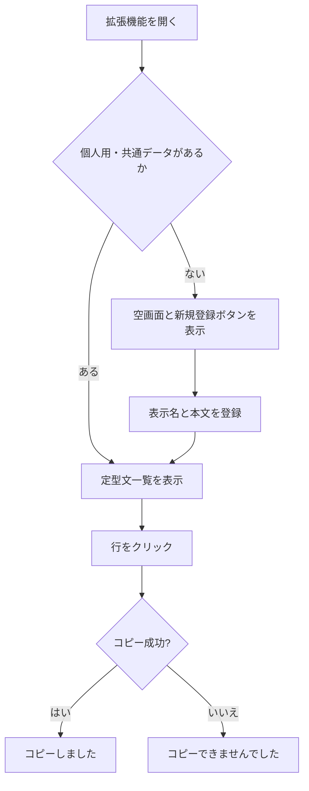
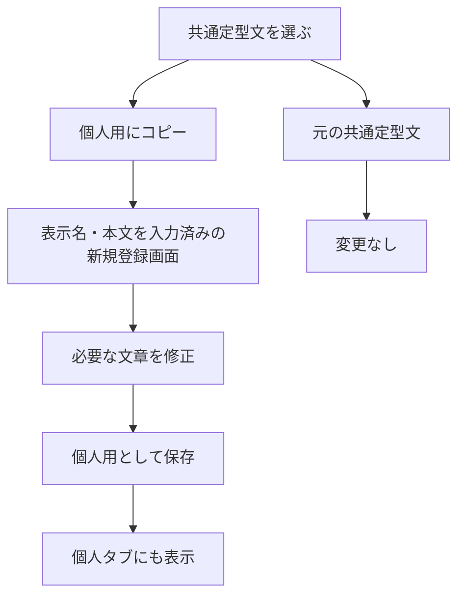

# 閉域イントラネット向け Chrome サイドパネル型「業務アシスタント」基本設計書

> **追記（2026-11-11 / v0.6.2・数値計算）**：既存の「＋ 機能」方式で数値計算モジュールを追加。4カテゴリ（割合・比較／金額・税／集計・単価／旅費・交通費）・9機能（割合・達成率、増減・前年比、消費税、補助金・率計算、端数処理、単価×数量、合計・平均、出張旅費の概算、交通費明細）。カテゴリ→機能→計算画面の3階層。手入力と共通クリック式テンキー（四則演算・括弧）に対応し、結果別にコピー可能。原則は入力値がそろった場合に自動計算し、結果欄に計算条件と端数処理を表示。詳細設定は折りたたみ。入力値・数式・交通費明細・計算履歴は永続保存しない。最近使った計算のID（最大3件）のみローカル保存・JSONバックアップ対象に追加（旧バックアップには値がなくても復元可能）。計算ロジックは独立した十進演算関数、UIは独立ファイル。ブラウザ外部通信・権限の追加なし。補助金・旅費は概算専用で制度判断不可。消費税は請求書全体の税額算定と区別する。自動テスト導入、職場Chrome実機検証は別途。


> **追記（2026-11-11 / v0.6.1・決定／実装）**：Chrome標準のサイドパネル見出し「うらちゃん」はそのまま使用し、パネル内部の重複するアイコン・「うらちゃんツール」の名称を表示しない。パネル上部には操作ボタンの独立行を配置し、ホーム画面は右寄せの歯車アイコン（設定）と文字付き「× とじる」、設定・各詳細画面は左端に「← 戻る」、右端に文字付き「× とじる」を表示する。機能切替タブは次行を維持。横スクロールバーを隠し、必要なときのみ左右移動ボタンを表示してマウス・キーボード操作を確保する。データや権限には変更なし。Chrome実機検証は未完了。


> **追記（2026-11-11 / v0.6.0）**：現行実装に「メモ・タスク」を追加。件名でクイック登録し、必要時のみ期限・対応履歴・最終回答・参考情報・★ナレッジ候補を追記する。期限通知や完了時の強制入力は行わず、完了は一覧チェックか詳細から直接実施。Markdown・CSV・JSON出力はユーザー操作でローカル保存し、AIへの自動送信は行わない。新しいバックアップはメモ・タスクを含み、旧バックアップは既存のメモを上書きしない。受付・回答情報は機密性に注意し、個人情報を入力しない。これは設計原本への追記で、本文中の旧シンプル／拡張モード説明などは現行仕様ではない。


> **追記（2026-11-11）**：画像変換（HEIC→JPEG/PNG、リサイズ、品質調整、ZIP）をv0.5.0に追加。ライセンスと検証状況は [README](../README.md)、[THIRD_PARTY_NOTICES](../THIRD_PARTY_NOTICES.md) を参照してください。本文は初期構想であり、最新仕様ではありません。

> **実装状況の追記（2026-11-10）**：この文書は構想段階の設計原本です。デモ版 v0.1.0 のソースコードはリポジトリ直下の `manifest.json`、`panel.html`、`panel.css`、`panel.js`、`background.js` に追加済みです。**職場PCでの実動作は未検証**です。最新の操作・実装範囲は [README](../README.md)、検証手順は [demo-test.md](demo-test.md) を参照してください。組織共通JSONの**作成・編集・書き出し機能はバージョン番号5回クリックで有効化する開発者モード**に置き、普段の共通文は直接編集せず個人用に複製して編集します。既存データとの互換性は初回デモでは不要とします。

> **文書の位置づけ**：構想・要件整理・基本設計（実装前ドラフト）  
> **版数**：v0.1  
> **作成日**：2026年11月10日  
> **対象**：自治体職員が利用する、外部通信を前提としない Chrome 拡張機能  
> **最初の実装対象**：定型文の登録・検索・ワンクリックコピー  
> **将来像**：文字変換・日付ツール等を段階的に追加する職員用ユーティリティパネル

---

## 0. 本書の読み方

本書は、これまでの検討内容を後続の設計・開発へ引き継ぐため、**決定事項・設計提案・未決事項を区別**して記述する。

- **【決定】**：会話で明示的に合意した方向性。実装時に原則維持する。
- **【提案】**：決定事項を実現するための具体化案。試作・レビューで変更可能。
- **【要確認】**：今後の実装または組織内展開の前に判断が必要な事項。
- **【将来】**：拡張に備えて構造を考慮するが、初版実装に含めるとは限らない事項。

**重要**：本書は完成済みアプリの仕様書ではない。画面・データ例・数値目標は、明記がない限り設計案である。

---

## 1. 背景と目的

### 1.1 背景

自治体の閉域ネットワークにおけるイントラネット・既存業務システムは、日常的にブラウザで操作される。一方、定型文の繰り返し入力、文書の表記統一、情報探索、画面間の転記・照合など、細かな非効率が存在する。既存システム本体の改修は費用・調整・運用上の制約が大きいため、Chrome拡張によって職員の操作環境側へ補助機能を追加することを検討する。

### 1.2 目的

1. よく使う文字・文章を保存し、ブラウザのサイドパネルから**1回のクリックでコピー**できるようにする。
2. 個人で登録した文章と、組織から配布された共通定型文を同じUIで利用できるようにする。
3. **説明書がなくても使える**画面と操作にすることで、利用者の学習負担と導入・運用時の問い合わせを抑える。
4. 機能を追加しても初めて使う職員の体験を複雑にしないため、**シンプルモード／拡張モード**を提供する。
5. 閉域ネットワークで運用可能な、**外部サーバー・クラウドサービスに依存しない**構成とする。

### 1.3 成功条件（提案）

- 初めて利用する職員が、マニュアルを読まずに「定型文をコピーする」「個人用に追加する」を実行できる。
- 共通定型文の再配布・再取り込みによって重複登録が起きない。
- 利用者の個人用データが、共通JSON取り込みによって消失・改変されない。
- 通信不能な環境で、登録・検索・コピー・編集・JSON入出力が成立する。
- 端末・Chromeプロファイルが変わった場合も、必要な情報をファイルで移行できる。
- 拡張機能を使わないとき、元の業務システムの表示や動作には影響しない。

※定量的な時間短縮率・問い合わせ削減率は、試作後に測定方法と目標を設定する。

---

## 2. 基本方針・設計原則

| ID | 方針 | 状態 | 補足 |
|---|---|---|---|
| P-01 | Chromeの**サイドパネル**を主要UIにする | 【決定】 | 元のページと並べて使う |
| P-02 | **個人PCの利用**を基本とする | 【決定】 | 共用PCの存在は認識するが、初版は個人PC優先 |
| P-03 | 外部サービスからの取得・外部通信を想定しない | 【決定】 | 拡張の主要機能はオフライン完結 |
| P-04 | 初期表示は**シンプルモード** | 【決定】 | 操作に迷いにくい構成 |
| P-05 | **拡張モードに機能メニュー**を設ける | 【決定】 | 機能増加に対応 |
| P-06 | タブ切り替えを採用 | 【決定】 | 「すべて／お気に入り／個人／共通」 |
| P-07 | お気に入りを採用 | 【決定】 | 個人用・共通の両方を対象 |
| P-08 | 定型文の**文字・行クリックでコピー** | 【決定】 | 別のコピーボタンを必須にしない |
| P-09 | 個人用定型文は利用者が登録・編集できる | 【決定】 | 削除も行える設計 |
| P-10 | 組織共通定型文はJSONファイルで配布・取り込み | 【決定】 | サーバーからの自動取得は想定しない |
| P-11 | **組織共通は原則として直接編集させない** | 【決定】 | 編集したければ個人用に複製してから編集 |
| P-12 | 画面自体が使い方を示す設計 | 【決定】 | わかりやすい文言・空状態・操作結果 |
| P-13 | 2モードは同じデータを参照する | 【提案】 | モード切替でデータを移動・複製しない |
| P-14 | 拡張機能は権限最小化、業務画面への介入なしで開始 | 【提案】 | 初版は他サイトのDOMを読まない |
| P-15 | データが失われ得る操作は事前確認または復元手段を提供 | 【提案】 | 問い合わせ・誤操作防止 |
| P-16 | 実装していない機能のメニューは原則表示しない | 【提案】 | 押しても使えないボタンを避ける |

### 2.1 UXの原則

- **主操作を1つにする**：定型文一覧の主操作は「コピー」。編集・複製・削除は副操作に分離する。
- **設定を隠して操作を隠さない**：普段不要な管理機能は設定側へ置くが、日常的に必要なコピー・検索・新規登録・お気に入りは見せる。
- **専門用語を避ける**：利用者向け文言は「取り込む」「書き出す」「コピーしました」とし、`schemaVersion` や JSON解析などの技術語を原則出さない。
- **勝手に情報を失わせない**：共通データと個人データは更新範囲を分離する。
- **拡張しても見た目を保つ**：追加メニューは拡張モードに集め、シンプルモードの操作方法は変えない。

---

## 3. 対象利用者と利用環境

### 3.1 利用者区分

| 区分 | 想定 | 主な操作 |
|---|---|---|
| 一般職員 | 個人PCのChrome利用者 | 共通・個人定型文のコピー、お気に入り、個人用登録・修正 |
| 共通定型文の配布担当者 | 担当部署・システム管理担当等 | 組織共通JSONの作成・更新・配布 |
| 拡張機能の配布管理者 | 情報システム管理担当等 | インストール・更新・ポリシー・問い合わせ一次対応 |
| 共用PC利用者 | 例外的利用ケース | 同一プロファイルを共用する場合のデータ共有に注意 |

**【決定】** 個人PCを前提に設計する。共用PCの職員識別・アカウント切替・ログイン機能は初版に実装しない。

### 3.2 動作環境

- OS：主に組織内のWindows端末を想定（**【提案】**）。
- ブラウザ：Google Chromeを対象とする。Side Panel APIはChrome 114以降で利用可能。実際の配布対象のChromeバージョンは要確認。
- ネットワーク：インターネットへ接続できない閉域ネットワーク、または外部通信を禁止した構成。
- 通信：**定型文機能の実行時にHTTP通信等を行わない**。JSONは利用者がファイルを選んで読み込む。
- 保存：Chromeプロファイル単位の `chrome.storage.local`。Chromeアカウントの同期を前提としない。
- 初版は既存システムへのログイン、サーバーAPIの利用、内容の取得・書換えを行わない。

### 3.3 共用PCへの注意

- **同じChromeプロファイルを複数職員で使う場合、登録データ・お気に入りはそのプロファイルを使う人に見える。**
- 初版では利用者の分離をしないため、共用PCでの個人的な情報登録は推奨しない。
- 共用PC向けの特別なモード、ログアウト、個人データ隔離等は【将来】検討とする。

---

## 4. 提供範囲・実装フェーズ

### 4.1 第1期：定型文コピー機能

**必須範囲（これまでの合意を具体化）**

- サイドパネル開閉
- シンプルモードを初期値とするモード切替
- すべて／お気に入り／個人／共通タブ
- 定型文の一覧表示・検索・クリックコピー
- お気に入りの設定・解除
- 個人用定型文の追加・編集・削除
- 組織共通JSONの取り込み・更新
- 組織共通定型文から個人用へのコピーと編集
- ローカル保存
- 個人用データのJSON書き出し・復元
- 説明書なしで使える空画面・処理完了・エラー表示
- 拡張モードのメニューの基本構造

### 4.2 第2期以降の候補【将来】

| 分野 | 追加候補 | 留意点 |
|---|---|---|
| 文字変換 | 全半角変換、前後・連続空白の削除、改行整形 | 元の文字を壊さないUIが必要 |
| 日付ツール | 和暦／西暦変換、日付計算、日付の整形 | 例外日付・元号境界に注意 |
| 便利ツール | 電話番号の整形、ファイル名生成、簡易計算 | 1操作で役立つものを選定 |
| リンク集 | よく使う庁内ページへのショートカット | URL登録・アクセス先の管理 |
| 文書補助 | 公用文表記チェック、定型文テンプレート | 組織ごとの運用ルールが必要 |
| 画面連動 | 特定システムの入力補助・一覧コピー・チェック | サイトアクセス権限・保守負荷が増える |
| 部署共通 | 部署ごとに異なるJSONセットを併用 | セット識別と更新ルールが必要 |

**方針**：将来モジュールを想定した設計にするが、使えない機能を大量に表示することは避ける。

### 4.3 初版の非対象

- インターネットからのデータ取得、クラウド同期、利用分析の送信
- 庁内サーバーへの登録情報の自動送信、サーバーデータベース
- ログイン、ユーザー認証、共用PCの個人切替
- Chromeプロファイル間のリアルタイム同期
- 組織共通定型文の直接編集
- 既存業務システムへの自動入力・自動クリック
- 画面内の住民情報等の取得
- AIによる自動生成や外部AI API利用

---

## 5. 情報アーキテクチャ・画面構成

### 5.1 画面の全体構成

```text
Chrome
└── サイドパネル：業務アシスタント
    ├── 共通ヘッダー
    │   ├── アプリ名・アイコン
    │   └── 設定（モード切替・データ管理）
    ├── シンプルモード（初期値）
    │   └── 定型文コピー画面
    │       ├── 検索
    │       ├── タブ（すべて／お気に入り／個人／共通）
    │       ├── 定型文一覧
    │       │   ├── 行クリック：コピー
    │       │   ├── ★：お気に入りの切替
    │       │   └── その他の操作：編集等へ
    │       └── ＋新しく登録
    └── 拡張モード
        ├── 機能メニュー
        │   ├── 定型文コピー（第1期）
        │   ├── 文字変換（将来）
        │   ├── 日付ツール（将来）
        │   └── 便利ツール（将来）
        ├── 定型文コピー（基本操作は同一）
        └── 管理・設定
            ├── 個人用定型文の管理
            ├── 共通定型文の取り込み
            ├── 個人データの書き出し・復元
            └── 表示モードの変更
```

### 5.2 シンプルモード【決定】

- 初回インストール時はシンプルモード。
- トップ画面は定型文コピー機能に直接入る。
- 画面上部に検索欄を置く。
- 「すべて」「★お気に入り」「個人」「共通」のタブを置く。
- 各行には定型文名、本文プレビュー、必要に応じて小さな「共通」ラベル、★を表示。
- 定型文の行（★やその他ボタン以外）をクリックすると本文全文をコピー。
- 新しい個人定型文を登録する操作はシンプルモードでも可能。
- 共通定型文を変更したい場合は、「個人用にコピー」を選ぶ。共通自体は変更しない。
- 通常の編集・削除など、頻度の低い管理操作は詳細画面または拡張モードへまとめる案とする。

### 5.3 拡張モード【決定】

- シンプルモードと**同じ定型文データ・お気に入り**を使用。
- 定型文コピーの操作感はそのまま維持。
- 機能メニュー（定型文、将来の文字変換、日付ツール、便利ツール等）を追加。
- 個人データ管理、共通JSON取り込み等の頻度が低い機能へアクセスしやすくする。
- 利用者が選択したモードをローカル保存し、次回起動時に復元する（【提案】）。
- 初版では「定型文」以外の未実装モジュールを無効ボタンとして並べず、実装された時点で表示する（【提案】）。

### 5.4 画面イメージ（テキストワイヤーフレーム）

**シンプルモード**

```text
┌─────────────────────────────┐
│ 🗐 業務アシスタント         ⚙ │
├─────────────────────────────┤
│ 🔍 定型文を検索...             │
│ [すべて][★お気に入り][個人][共通] │
├─────────────────────────────┤
│ 所属名                  ★     │
│ 総務部 デジタル推進課          │ ← 行クリックでコピー
├─────────────────────────────┤
│ 回答依頼文  [共通]       ☆     │
│ 内容をご確認のうえ、...        │ ← 行クリックでコピー
├─────────────────────────────┤
│ ＋ 新しく登録                 │
└─────────────────────────────┘
```

**拡張モード（機能追加後の構想）**

```text
┌─────────────────────────────┐
│ 🗐 業務アシスタント         ⚙ │
├─────────────────────────────┤
│ [定型文] [文字変換] [日付]      │
│ [便利ツール]                 │
├─────────────────────────────┤
│  ※「定型文」選択時、基本の    │
│    一覧・検索・コピーUIを表示   │
├─────────────────────────────┤
│ [データ管理] [各種設定]         │
└─────────────────────────────┘
```

### 5.5 モード切替【提案】

- ヘッダーの「設定」から切り替える。画面上の常時大きなモード切替ボタンは置かない。
- 設定項目表示例：「表示モード：● シンプル / ○ 拡張」。
- モード変更でデータやお気に入りは変化しない。
- 「シンプルに戻す」操作を拡張モード側から見つけやすくする。
- モードはChromeプロファイルごとに保存。

### 5.6 タブ・検索【決定と提案】

| タブ | 表示対象 |
|---|---|
| すべて | 個人用＋組織共通の全件 |
| ★お気に入り | お気に入り登録済みの個人用＋組織共通 |
| 個人 | 個人用のみ |
| 共通 | 組織共通のみ |

- 検索対象：定型文の表示名とコピー本文。
- 検索条件は現在のタブ内に適用。
- 検索は入力に合わせて即時絞り込み（【提案】）。
- 並べ替えの既定順は「登録または配布された表示順」を尊重する（【提案】）。
- タブを変えても検索文字列を保持するかどうかは試作で確認（【要確認】）。
- 件数0の場合は理由が伝わる文言と、必要に応じて検索解除を表示。

### 5.7 コピー操作【決定】

1. 利用者が一覧から定型文の行をクリックする。
2. その定型文の**本文全文**をクリップボードへコピーする。
3. 成功後、「コピーしました」を短く表示する。
4. 利用者は、別のフォームや文書へ通常の貼り付け操作を行う。

**注意すべき仕様**

- 本文はプレビューが途中まででも、コピー時には全文を使う。
- 複数行、空行、記号、半角／全角文字は原則そのまま維持する。
- 成功表示は書き込み完了後だけ出す。失敗時に「コピーしました」と出さない。
- ★ボタン・編集ボタン・その他メニュー押下ではコピーさせない（イベントの伝播制御）。
- ダブルクリックや連打で画面が壊れないようにする。
- コピーは平文テキストを基本とし、HTML書式などのコピーは対象外。
- クリップボードには直近にコピーした値が残るため、機微情報の登録は禁止する運用とする。

### 5.8 視認性・アクセシビリティ【提案】

- 文字が途中で省略されても詳細を開けば全文確認できる。
- 幅が狭いパネルでも横スクロールを極力発生させない。
- ★等のアイコンにはマウスオーバー時の説明、キーボード操作時の識別名を付ける。
- コピー対象の行はマウスだけでなくEnter/Spaceでも動作できるようにする。
- フォーカス表示とボタンの押しやすさを確保する。
- コピー完了のフィードバックは色だけに依存させず文字でも示す。
- サイドパネルの左右配置はChrome側の設定に依存し得るため、「必ず右固定」とはしない。

---

## 6. 機能要件一覧

### 6.1 基本操作

| ID | 優先 | 要件 | 振る舞い・受入れ条件 |
|---|---|---|---|
| FR-001 | 必須 | サイドパネル表示 | 拡張機能のアイコン等から開ける |
| FR-002 | 必須 | 初期モード | 新規導入はシンプルモードで開始 |
| FR-003 | 必須 | モード切替 | 設定からシンプル／拡張を切替可能 |
| FR-004 | 必須 | モード記憶 | 再起動しても選択モードを保持（提案） |
| FR-005 | 必須 | タブ | すべて／お気に入り／個人／共通を選択可能 |
| FR-006 | 必須 | 定型文一覧 | ラベル・本文プレビュー・共通表示・お気に入り状態を表示 |
| FR-007 | 必須 | 検索 | ラベルと本文の一致で絞り込み |
| FR-008 | 必須 | 行クリックコピー | 対象本文をクリップボードへ書込 |
| FR-009 | 必須 | 完了表示 | 成功／失敗を誤認しないメッセージ |
| FR-010 | 必須 | お気に入り | 個人／共通のどちらも★を切替可能 |
| FR-011 | 必須 | お気に入り保持 | タブ・モード切替やブラウザ再起動後も保持 |

### 6.2 個人用定型文

| ID | 優先 | 要件 | 振る舞い・受入れ条件 |
|---|---|---|---|
| FR-101 | 必須 | 新規登録 | 表示名とコピー本文を入力して保存 |
| FR-102 | 必須 | 編集 | 登録した表示名と本文を変更可能 |
| FR-103 | 必須 | 削除 | 個人用を削除できる。誤操作対策あり |
| FR-104 | 必須 | 検索対象 | 個人用も全体・個人タブの検索対象 |
| FR-105 | 必須 | ローカル保持 | Chromeを閉じても個人用データを保持 |
| FR-106 | 推奨 | 複数行本文 | 入力した改行・空白をコピー時に保持 |
| FR-107 | 推奨 | 削除取消 | 削除直後に「元に戻す」（提案） |
| FR-108 | 将来 | 並び順編集 | ドラッグ等による並び順変更 |

### 6.3 組織共通定型文

| ID | 優先 | 要件 | 振る舞い・受入れ条件 |
|---|---|---|---|
| FR-201 | 必須 | 共通JSON取り込み | ファイル選択から組織共通定型文を登録 |
| FR-202 | 必須 | 再取り込み | 同じセットの取り込みで重複登録しない |
| FR-203 | 必須 | 変更差し替え | セットの更新によって対象共通データだけを更新 |
| FR-204 | 必須 | 編集不可 | 共通定型文の本文・表示名を直接変更できない |
| FR-205 | 必須 | 個人用にコピー | 選択した共通定型文を個人用の新規編集画面へ複製 |
| FR-206 | 必須 | 原本保全 | 個人用への複製・編集によって共通側を変更しない |
| FR-207 | 必須 | 個人用保全 | 共通更新で個人用の内容を変更しない |
| FR-208 | 必須 | お気に入り維持 | 同一共通項目IDが残る場合、★状態を維持（提案） |
| FR-209 | 推奨 | 取り込みプレビュー | 追加・更新・削除件数等を事前表示 |
| FR-210 | 推奨 | セット情報 | 共通定型文の名称、版数、取り込み日時を確認可能 |
| FR-211 | 将来 | 複数セット | 全庁／部署などの複数の配布セットを併用 |

### 6.4 データ移行・管理

| ID | 優先 | 要件 | 振る舞い・受入れ条件 |
|---|---|---|---|
| FR-301 | 必須 | 個人用書き出し | JSONファイルとして保存できる |
| FR-302 | 必須 | 個人用復元 | 保存したJSONを選択して復元できる |
| FR-303 | 必須 | 範囲分離 | 個人用復元で共通定型文そのものを変更しない |
| FR-304 | 必須 | JSON検証 | 誤ったファイルで既存データを壊さない |
| FR-305 | 必須 | 復元前確認 | 上書き範囲・件数を表示する（提案） |
| FR-306 | 推奨 | インポート結果 | 成功件数・失敗時理由を平易に表示 |
| FR-307 | 推奨 | バックアップ名 | 保存日付等をファイル名に含める |
| FR-308 | 将来 | 共通JSON作成支援 | 管理者が配布セットを編集・検証・書き出せるツール |

### 6.5 機能メニュー・追加拡張

| ID | 優先 | 要件 | 振る舞い・受入れ条件 |
|---|---|---|---|
| FR-401 | 必須 | 拡張メニュー | 拡張モードに機能選択領域を設ける |
| FR-402 | 必須 | 定型文機能の共通化 | モード間で登録・お気に入りを共有 |
| FR-403 | 推奨 | 将来モジュール追加性 | 追加機能を独立した画面・ロジックで実装可能 |
| FR-404 | 推奨 | 未実装項目を隠す | 利用不能な機能を通常表示しない |
| FR-405 | 将来 | 文字変換／日付等 | 別途機能設計後に追加 |

---

## 7. 主要操作フロー

### 7.1 初回利用



- 初回起動時に長いチュートリアルやモーダルを強制しない。
- 初回の空画面例：**「まだ定型文がありません。よく使う文字を登録すると、クリックでコピーできます。」**
- ボタン例：**「＋ 最初の定型文を登録」**

### 7.2 個人用定型文の登録

1. 「＋新しく登録」を押す。
2. 「名前（一覧に表示）」と「コピーする文字・文章」を入力する。
3. 「保存」を押す。
4. 保存が完了したら一覧へ戻り、登録した定型文が表示される。
5. 保存できない場合は入力欄の近くに理由を表示する。

**入力欄の例**

| 欄 | 必須 | 例 | 備考 |
|---|---|---|---|
| 名前 | 必須 | 所属名 | 一覧で見分けるための短いラベル |
| コピーする文字・文章 | 必須 | 総務部 デジタル推進課 | 文字列は改行も保持 |

- 「名前」は前後空白を除去して保存することを提案。
- 「コピーする文字・文章」は、意図した改行・前後空白を維持する。全空白・空文字の場合のみ登録不可とする案。
- 長文の上限値・件数上限は試作時の性能を踏まえて決める（【要確認】）。

### 7.3 共通定型文を個人用にコピーして編集



- 共通定型文の主操作は通常どおり「コピー」。個人用への複製は詳細・その他操作から行う。
- 複製時、**新しい個人用IDを発行**する。元の共通項目と同じIDを使わない。
- 初期表示名は「回答依頼文（個人）」などにして区別する案もあるが、勝手な改名が煩雑なら原文のままとし、重複名を許容する（【要確認】）。
- 複製直後のお気に入り状態は初期OFFとする案（【提案】）。

### 7.4 共通JSON取り込み・更新

1. 「設定」または「データ管理」から「共通定型文を取り込む」を開く。
2. JSONファイルを選択する。
3. **ファイル形式・必須項目・ID重複等を検証**する。
4. 既存の同一セットと比較して「新規／更新／変更なし」を判定する。
5. 必要な場合のみ、追加・変更・削除件数を提示する。
6. 利用者が「取り込む」を実行する。
7. 取り込み成功後に更新した件数と取り込み日時を表示する。

**【提案】更新ルール**

- 同じ `setId` のデータは**同一の共通定型文セット**と判定する。
- 取り込みはセット単位の差し替え方式とする。個々の定型文を単純に追加し続けない。
- 共通側の項目IDが継続していれば、お気に入りは可能な限り維持する。
- 更新版で項目が削除されたら、その項目は共通タブから消える。お気に入り参照も整理する。
- 個人用にコピーした文章は更新しても変わらない。
- ファイルが不正な場合、**既存セットを一切変更しない**。
- 書き込みエラー時は可能な限り処理前状態へロールバックし、途中まで適用された状態を避ける。

### 7.5 個人用データの書き出し・復元

- 「個人データを書き出す」でJSONを保存する。
- 保存対象は個人定型文と個人の設定・お気に入り状態を基本とする（【提案】）。
- 「個人データを復元する」は、現行データを置き換える方式を初版の候補とする。ただし、**取り込み前に上書き範囲を明示して確認を取る**。
- 共通定型文本体は配布JSONから再取り込みする前提。バックアップに含めるかどうかは【要確認】。
- JSONを書き出した時点でファイルにデータが平文で保存される。保存先と持ち運びに注意が必要。

---

## 8. データモデル（設計提案）

### 8.1 データ区分

| 区分 | 説明 | 更新主体 | 保存先 |
|---|---|---|---|
| personalItems | 個人用定型文 | 利用者 | `chrome.storage.local` |
| sharedSets | JSON配布の組織共通セット | 配布JSONの取り込み処理 | `chrome.storage.local` |
| favorites | お気に入り参照 | 利用者 | `chrome.storage.local` |
| settings | モード・選択タブ等 | 利用者／アプリ | `chrome.storage.local` |
| schemaVersion | ローカルデータ構造版 | アプリ | `chrome.storage.local` |

**重要**：個人用と共通用はデータレイヤーで明確に分離する。表示は統合してよいが、削除・インポート・復元等の更新範囲は分離する。

### 8.2 個人定型文の内部データ例

```json
{
  "id": "p-7f4a1c",
  "title": "所属名",
  "text": "総務部 デジタル推進課",
  "order": 10,
  "createdAt": "2026-11-10T09:00:00+09:00",
  "updatedAt": "2026-11-10T09:00:00+09:00"
}
```

- `id`：再編集しても変わらない内部識別子（ユーザーには非表示）。
- `title`：一覧に表示する名前。
- `text`：コピー対象の文字列そのもの。
- `order`：表示順を将来管理できるよう設ける提案。
- 日付情報はバックアップ・将来の移行に備える提案。時刻形式はISO 8601。

### 8.3 組織共通JSONの例

以下は**本設計書で提案する新規フォーマット**であり、既存の正式仕様を意味しない。

```json
{
  "format": "office-assistant-shared",
  "schemaVersion": 1,
  "set": {
    "id": "organization-common",
    "name": "全庁共通定型文",
    "version": "2026.11.1",
    "publishedAt": "2026-11-10"
  },
  "items": [
    {
      "id": "request-reply",
      "title": "回答依頼文",
      "text": "内容をご確認のうえ、ご回答くださいますようお願いいたします。",
      "order": 10
    },
    {
      "id": "thank-you",
      "title": "お礼文",
      "text": "ご対応いただき、ありがとうございました。",
      "order": 20
    }
  ]
}
```

| フィールド | 必須案 | 説明 |
|---|---|---|
| `format` | ○ | ファイルの種類を識別 |
| `schemaVersion` | ○ | JSON構造の互換判定 |
| `set.id` | ○ | 同一共通セットの識別（更新のキー） |
| `set.name` | ○ | 利用者向けに表示するセット名 |
| `set.version` | ○ | 配布版数・更新確認用の識別子 |
| `set.publishedAt` | 任意 | 配布・公開日 |
| `items[].id` | ○ | セット内で不変の項目ID |
| `items[].title` | ○ | 定型文の表示名 |
| `items[].text` | ○ | コピー本文 |
| `items[].order` | 任意 | 表示順 |

**設計上の重要ルール**

1. `set.id` は版が変わっても固定する。
2. 同じ定型文の `items[].id` は、文章修正や名称変更後も固定する。
3. 異なる項目へ既存IDを使い回さない。
4. 項目を削除する場合は更新版の `items` から除外する。
5. 変更版は管理側で `set.version` を更新することを運用ルールとする。ただし実際の差分判定はIDと内容でも検証する。
6. 表示時にJSON内文字列をHTMLとして実行せず、プレーンテキストとして処理する。
7. フォーマット不明・必須項目不足・ID重複・異常に大きな入力は取り込みを拒否する。

### 8.4 お気に入りの参照設計

個人IDと共通IDの衝突を避けるため、例として以下の識別方式を用いる。

```json
{
  "favorites": [
    "personal:p-7f4a1c",
    "shared:organization-common:request-reply"
  ]
}
```

- `shared:{setId}:{itemId}` で共通の項目を一意に特定。
- 共通JSONを更新しても両方のIDが維持されれば★を維持。
- 共通項目がなくなった場合は参照を削除または無効化し、架空の定型文を一覧に残さない。

### 8.5 個人用バックアップJSON例

```json
{
  "format": "office-assistant-personal-backup",
  "schemaVersion": 1,
  "exportedAt": "2026-11-10T09:30:00+09:00",
  "personalItems": [
    {
      "id": "p-7f4a1c",
      "title": "所属名",
      "text": "総務部 デジタル推進課",
      "order": 10,
      "createdAt": "2026-11-10T09:00:00+09:00",
      "updatedAt": "2026-11-10T09:00:00+09:00"
    }
  ],
  "favorites": [
    "personal:p-7f4a1c",
    "shared:organization-common:request-reply"
  ],
  "settings": {
    "mode": "simple"
  }
}
```

- 組織共通の本文は原則バックアップファイルに含めない方針を提案する。別途共通JSONを再取り込みして復元する。
- 共通のお気に入り情報が未取り込みで参照できない場合は、後に同一セットを取り込んだ際に再び有効とするか、復元時に整理するかを決める（【要確認】）。
- バックアップと組織共通JSONは `format` で厳密に区別し、誤取り込みを防ぐ。

### 8.6 バージョン・互換性【提案】

- `schemaVersion` はJSONの構造が変わる場合に更新。
- `set.version` は組織共通の内容版数として運用し、アプリ版数と混同しない。
- 拡張機能自体のバージョンは `manifest.json` に持つ。
- 現行アプリが理解できない新しい `schemaVersion` のJSONは、無理に読み込まず「このファイルは新しい形式です。拡張機能を更新してください」と表示する。
- 既存データからの移行処理は、スキーマ変更時にテストを必須とする。

---

## 9. JSON取り込み・書き出し仕様

### 9.1 共通取り込みのユーザー表示例

正常時：

> 共通の定型文を更新しました。  
> 追加：5件／変更：3件／削除：2件

変更なし：

> この定型文はすでに取り込まれています。変更はありません。

不正ファイル：

> このファイルは取り込めません。配布された定型文ファイルを選び直してください。現在の定型文は変更されていません。

### 9.2 エラー判定

- ファイルを選択しなかった：何もしない。エラー扱いしない。
- JSONの構文エラー：取り込み不可。
- `format` が違う：別用途のファイルとして案内。
- `schemaVersion` が非対応：取り込み不可、拡張機能の更新案内。
- `set.id` 不足、`items` 非配列、項目ID重複：取り込み不可。
- 必須文字列が空：取り込み不可。
- 件数やサイズが実装上の上限を超える：取り込み不可、具体的に案内。
- 保存エラー：保存前の状態を維持し、再試行案内。

### 9.3 整合性

- **検証完了前に既存データを更新しない。**
- セット全体を検証してから新状態へ切り替える。
- 処理中に画面を閉じても破損が起きないよう、処理単位を小さくする。
- 取り込み前後の件数とセットIDをログの代わりに利用者が画面で確認できるようにする（機微情報は含めない）。

### 9.4 ファイル名の例【提案】

- 共通配布：`organization-common_2026-11-10.json`
- 個人書き出し：`gyomu-assistant_personal_2026-11-10.json`

ファイル名は識別補助であり、**更新の正式なキーはファイル名ではなくJSON内部の `set.id`** とする。

---

## 10. エラー・空状態・確認表示

### 10.1 初回・空状態

| 状況 | 表示例 | 行動 |
|---|---|---|
| 何も登録なし | 「まだ定型文がありません。よく使う文字を登録すると、クリックでコピーできます。」 | 「＋最初の定型文を登録」 |
| お気に入り0件 | 「お気に入りはまだありません。★を押すとここに表示されます。」 | 一覧へ戻る |
| 共通0件 | 「共通の定型文はまだ取り込まれていません。」 | 共通JSON取り込みへの案内 |
| 検索結果0件 | 「該当する定型文がありません。」 | 検索条件を消す |

### 10.2 操作結果の表示

| 操作 | 成功 | 失敗 |
|---|---|---|
| コピー | 「コピーしました」 | 「コピーできませんでした。もう一度お試しください。」 |
| 新規登録 | 「登録しました」 | 「保存できませんでした。もう一度お試しください。」 |
| 変更 | 「変更しました」 | 「変更内容を保存できませんでした。」 |
| 削除 | 「削除しました　元に戻す」 | 「削除できませんでした。」 |
| 共通取り込み | 「共通の定型文を更新しました」 | 「取り込めません。元のデータは変更されていません。」 |
| 書き出し | 「ファイルを保存しました」※保存確認できた場合 | 「書き出せませんでした。」 |

**設計原則**：コピー失敗や保存失敗なのに成功表示しない。技術的な例外内容は内部のデバッグ用途にとどめる。

### 10.3 削除と復元

- 個人用を削除するときは共通を削除できないことを保証。
- 単一項目の削除後は「元に戻す」を短時間提供する案。
- まとめて置換する復元や共通セットの差し替えは、事前確認を優先する。
- 確認ダイアログが頻発して日常操作の邪魔にならないようにする。

---

## 11. 技術構成・実装方針

### 11.1 採用技術【提案】

| 項目 | 技術・方式 | 理由 |
|---|---|---|
| 拡張方式 | Chrome Extensions / Manifest V3 | 現行の拡張仕様 |
| UI | `chrome.sidePanel`、HTML/CSS/JavaScript | 既存ページの横に表示可能 |
| 保存 | `chrome.storage.local` | 通信なしでローカル保持 |
| クリップボード | `navigator.clipboard.writeText()` 等 | ボタンクリックで平文コピー |
| 共通データ | ローカルJSONファイルの選択・解析 | 外部通信不要 |
| 個人バックアップ | JSON生成・ファイル保存 | PC移行・障害復旧 |
| 背景処理 | 必要最小限のService Worker | パネル起動設定など |
| 拡張性 | 機能別モジュール分離 | 将来追加時の影響範囲縮小 |

※正確なAPI権限の組合せと利用可否は対象Chromeバージョンで実機検証する。

### 11.2 最初に考える権限【提案】

```json
{
  "manifest_version": 3,
  "name": "業務アシスタント",
  "version": "0.1.0",
  "permissions": ["sidePanel", "storage", "clipboardWrite"],
  "action": {
    "default_title": "業務アシスタントを開く"
  },
  "side_panel": {
    "default_path": "sidepanel.html"
  }
}
```

これは**概念を示す最小案**であり、完成した `manifest.json` ではない（アイコンや各ファイル等は省略）。`clipboardWrite` が実装方式に対して必須かどうかも検証し、不要なら削る。

初版では原則として以下を付与しない。

- 全Webサイトへの `host_permissions`
- `activeTab`、`tabs`、`scripting`
- `clipboardRead`（クリップボード内容を読む権限）
- 外部URLへのアクセス許可

将来、既存業務システムの画面を読む機能を追加する場合は、用途・アクセス先・個人情報への影響を再検討し、機能単位で権限を増やす。

### 11.3 コンポーネント構成【提案】

```text
manifest.json
service-worker.js              # サイドパネルの起動設定など
sidepanel.html                 # UIエントリーポイント
assets/                        # アイコン等、すべてローカル同梱
src/
  app.js                       # モード・画面遷移
  features/
    snippets/
      snippet-list.js          # 一覧・検索・タブ
      snippet-editor.js        # 個人用登録・編集
      clipboard.js             # クリックコピー
      shared-import.js         # 共通JSON読み込み・検証
      personal-backup.js       # 個人JSON入出力
    tools/                     # 将来機能
  storage/
    repository.js              # ローカル保存インターフェース
    migrations.js              # データ版更新
  ui/
    toast.js                   # 短い処理結果通知
    dialogs.js                 # 確認UI
  styles/
    base.css
```

**実装上の推奨**：各画面が直接 `chrome.storage.local` を好き勝手に更新するのではなく、保存ロジックを共通のRepositoryへ集約する。

### 11.4 ローカル保存と障害対策

- `chrome.storage.local` はChromeプロファイル内の保存領域であり、拡張機能の削除でデータが消える。
- 端末交換、Chromeプロファイル削除、ブラウザの再セットアップではデータ移行が必要になる場合がある。
- Chromeの同期ストレージ `storage.sync` は利用しない。
- ローカル保存先は暗号化された機密保管庫とはみなさない。
- 件数・データ容量の上限を設け、保存容量超過時には既存データを維持したまま案内する。
- 大量の定型文を読み込んでもUIが応答しなくならないよう、必要に応じて表示件数やレンダリングを制御する。

### 11.5 通信を行わない設計

- 外部CDN、Webフォント、外部解析SDK、クラッシュ送信サービス等を組み込まない。
- 外部からJavaScriptやスタイルを取得しない。
- 拡張機能で使うスクリプト・画像・CSSはパッケージに同梱する。
- 共通定型文JSONは、利用者が明示的に選択したファイルのみ読み込む。
- イントラネットの業務システム自体の通信は、本拡張機能の通信とは別物として扱う。
- 将来機能でネットワークアクセスが必要になった場合は初版方針と切り離して再設計する。

---

## 12. セキュリティ・個人情報・運用統制

### 12.1 登録を想定する情報

**登録してよい例**

- 所属名、連絡先として公表可能な電話番号・メールアドレス
- 一般的な依頼文・お礼文
- 公用文の一般的な定型表現
- 固有の個人情報を含まない文書タイトル・表記

**原則として登録しない情報**

- パスワード、APIキー、認証用トークン
- 住民の氏名・住所・個人番号等を含む案件固有情報
- 他者の機微情報・厳格なアクセス制御が必要な情報
- 端末やプロファイルの共用により漏れると問題となる情報

※登録可否の最終判断は導入組織の情報セキュリティポリシー・取扱規程に従う。

### 12.2 アプリ側で講じる対策【提案】

- 定型文をHTMLとして描画・実行せず、文字列としてエスケープ表示する。
- JSON形式、データ型、ID、上限サイズを検証する。
- 読み込みJSONに含まれる不明な実行指示やスクリプトを処理しない。
- JavaScriptの `eval` 等を利用しない。
- 初版はWeb閲覧ページにコードを挿入せず、閲覧ページの内容を収集しない。
- 登録内容をログへ大量出力しない。デバッグ情報は個人情報を含まない範囲に限定する。
- コピー成功時にだけ完了表示し、失敗時の情報漏れ・誤転記を防ぐ。
- 拡張のアップデート時にも個人データを維持するテストを実施する。

### 12.3 認証・改ざん対策に関する留意点

- 共通JSONは**「ファイルに書かれているから組織公認」と判定できるわけではない**。配布経路・ファイルの管理ルールを組織内で整える必要がある。
- ファイルの電子署名・チェックサム検証は【将来／要確認】。初版は信頼できる庁内配布経路を前提とする。
- 組織共通の直接編集を禁止しても、ファイル自体を書き換えられる場合は内容の信頼性を保証できない。配布責任と配布手順が重要。
- システム権限や公用文の正当性は拡張機能だけでは保証できない。コピーされた文章の最終確認は利用者が行う。

---

## 13. 配布・更新・保守の設計

### 13.1 拡張機能本体の配布

**【重要・要確認】** Google ChromeのWindows/macOS環境でChrome Web Store外の独自拡張を正式に配布するには、原則として**組織管理ポリシーを通じた配布**が必要。開発者モードの「パッケージ化されていない拡張機能を読み込む」は試作・検証用途と考える。

- 試作段階：検証端末で開発者モードから読み込み、APIと操作性を確認。
- 本番候補：情報システム管理者と協議し、管理ポリシーによる配布方法を検討。
- 本体更新：既存配布方法に合わせ、庁内管理された配布・更新の仕組みを検討。
- 配布・更新に内部HTTPサーバーが必要となる場合でも、**定型文データの外部取得を行う構成とは区別**する。
- 拡張機能ID・バージョン・更新URL等の運用詳細は端末管理方式に応じて別途設計する。

### 13.2 組織共通JSONの運用

1. 共通定型文の管理担当者が配布ファイルを作成。
2. 配布前にJSON形式と内容を検証。
3. 組織が認めるイントラネット上の共有場所、ファイル配布方法等で配布。
4. 職員が必要時にファイルを選んで取り込む。
5. 新版配布時は同じ `set.id` に対して置換取り込みする。

**定型文の更新にアプリ本体の再配布は不要**とする一方、手動配布・手動取り込みなので、全職員への自動反映は行われない。周知と配布版管理は運用側の課題となる。

### 13.3 運用負担を減らすための考え方

- 利用者向け説明文は画面に直接組み込む。長いマニュアルを必須にしない。
- 共通JSONは極力1ファイルにまとめる。ただし部署別の要望が増えたら複数セットへ拡張する。
- アプリ本体と共通定型文は更新頻度を分離する。
- JSON不正時はすぐに理由がわかり、既存データが残るようにする。
- 「共通を自分向けに変更したい」という問い合わせは、共通の詳細画面に「個人用にコピー」を設置して解消する。
- 個人PC以外で利用する場合は、プロファイルを共用しないよう運用上の注意を示す。

---

## 14. 非機能要件

| ID | 分類 | 要件・設計目標 |
|---|---|---|
| NFR-01 | オフライン | 拡張の基本機能は外部通信なしで利用可能 |
| NFR-02 | 操作性 | 説明書なしに主操作が理解できる。画面内の文言で補助 |
| NFR-03 | 一貫性 | 両モードでコピー・検索・お気に入りの動作を統一 |
| NFR-04 | 可用性 | 元のイントラページが開けなくても登録済み定型文は利用可能 |
| NFR-05 | データ保全 | 保存失敗・不正JSONで既存の個人データが失われない |
| NFR-06 | プライバシー | 不必要なサイト・クリップボード読取り・外部送信を行わない |
| NFR-07 | 保守性 | UI・定型文・保存・JSON処理を分離し、機能増築時の変更を限定 |
| NFR-08 | 移行性 | JSONで個人データの手動移行を可能とする |
| NFR-09 | アクセシビリティ | キーボード操作、適切なラベル、色以外の結果表示 |
| NFR-10 | 性能 | 一般的な職員PCで検索・コピー時の応答が自然であること。数値目標は試作後確定 |
| NFR-11 | 表示互換 | Chromeサイドパネルの幅に応じて表示が破綻しない |
| NFR-12 | 更新互換 | 拡張本体の更新後も既存登録データを維持 |

---

## 15. 受入れ試験・確認観点

### 15.1 コア機能

| ID | 試験項目 | 期待結果 |
|---|---|---|
| T-001 | 新規導入後の初回起動 | シンプルモードで表示される |
| T-002 | 初回の空画面 | 新規登録への導線が理解できる |
| T-003 | 個人用登録 | 保存後に一覧へ表示される |
| T-004 | 複数行本文を登録・コピー | 改行含めて元の内容が貼り付けられる |
| T-005 | 定型文の行をクリック | 本文がコピーされ、成功表示される |
| T-006 | ★をクリック | お気に入りのみ変わり、コピーは実行されない |
| T-007 | 4タブを切り替え | 対象区分どおりに一覧が変わる |
| T-008 | 検索 | タイトルと本文で絞り込める |
| T-009 | モードを切り替え | 登録内容・お気に入りが変わらない |
| T-010 | Chrome再起動 | 個人用・共通・お気に入り・モードが保持される |

### 15.2 共通データ

| ID | 試験項目 | 期待結果 |
|---|---|---|
| T-101 | 有効な共通JSONを初回取り込み | 共通タブへ登録される |
| T-102 | 同じJSONを再取り込み | 重複しない |
| T-103 | 同一セット更新版を取り込み | 共通だけ更新。個人用は不変 |
| T-104 | 共通項目IDを維持して本文更新 | 共通本文は更新、★は維持 |
| T-105 | 共通項目を削除した更新版 | 共通一覧から削除され、古い★が誤表示されない |
| T-106 | 共通を個人用へコピー | 個人用として別項目が作成される |
| T-107 | 個人用にコピーした内容を編集 | 元の共通項目は変わらない |
| T-108 | 不正JSONを読み込み | 取り込み失敗を表示、既存データ不変 |
| T-109 | 同一セットに重複した項目ID | 検証で拒否される |

### 15.3 バックアップ・その他

| ID | 試験項目 | 期待結果 |
|---|---|---|
| T-201 | 個人用を書き出し | JSONファイルが生成できる |
| T-202 | 別プロファイル相当へ復元 | 個人用定型文が再現される |
| T-203 | 復元時に共通データがある | 共通本文は変更されない |
| T-204 | ストレージ容量不足 | わかりやすく失敗を表示し、元データを保つ |
| T-205 | コピー不可状態を模擬 | 成功メッセージを出さない |
| T-206 | 外部ネットワーク遮断状態 | 全コア操作が使える |
| T-207 | 共用プロファイルで起動 | 同一プロファイルのデータが見えることを確認し、運用上の注意を明確化 |
| T-208 | キーボードのみで操作 | コピー・タブ・お気に入り等の主要操作が可能 |
| T-209 | サイドパネルを狭くする | 主要操作が隠れたり重なったりしない |
| T-210 | 拡張をバージョンアップ | 保存済みデータを維持 |

### 15.4 利用者テスト（推奨）

- 初めて見る職員に説明をせず、①定型文をコピー、②お気に入り、③個人用登録を操作してもらう。
- 迷った位置・理解できなかった文言・誤クリックを記録する。
- 問い合わせ削減を重視するため、機能数よりも**説明なしで完了できる割合**を指標にする。
- 共通JSONの取り込みは一般職員にとって実施頻度が低いため、初見でも安全に実施できることを重視する。

---

## 16. 未決事項・今後の判断ポイント

| ID | 項目 | 現時点の推奨 | 理由／影響 |
|---|---|---|---|
| O-01 | 正式なアプリ名 | 仮称「業務アシスタント」 | 利用者への名称は短くする |
| O-02 | Chrome対象バージョン | 管理対象端末の実バージョンを確認 | Side Panel等の対応確認 |
| O-03 | 本番の拡張配布方式 | 組織管理ポリシーによる配布を情報担当と調整 | 運用可否を左右する |
| O-04 | 共通JSON配布責任者 | 部署・組織で定義 | 記載内容の正確性管理 |
| O-05 | 共通JSON取り込みの画面位置 | 設定／データ管理に集約 | 初期画面を複雑にしない |
| O-06 | 共通セット数 | 初版は1セットを推奨 | 複数セットは将来拡張しやすく設計 |
| O-07 | 個人用複製時の名前 | 同名を許容する案 | 自動改名の好みは実機で検討 |
| O-08 | 新規複製後の★ | OFFで開始する案 | 意図しないお気に入り増加を防ぐ |
| O-09 | 個人復元の方式 | 置き換え＋内容確認 | 重複・衝突を避ける |
| O-10 | バックアップ対象 | 個人用・設定・お気に入り。共通本文は含めない案 | 配布元と責任を分離 |
| O-11 | 共通お気に入り参照の復元 | セット未取り込み時の扱いを確定 | 端末交換時の体験に影響 |
| O-12 | 1件あたりの文字数・全体件数上限 | 試作後に確定 | 性能・容量・操作性 |
| O-13 | 項目並べ替え | 初版は優先しない | お気に入り・検索で代替 |
| O-14 | 個人用編集の導線 | 拡張モードまたは詳細画面 | シンプルモードの見やすさとの両立 |
| O-15 | 共通JSONの改ざん検知 | 信頼できる配布経路を初版の前提にする | 強い検証が必要なら電子署名等 |
| O-16 | メニューの最初の追加機能 | 文字変換を候補とする | 閉域・サーバー不要で実装可能 |
| O-17 | モード状態以外の設定保持 | 選択タブ・検索文字等の保存範囲を決定 | 予期しない状態復元を避ける |

---

## 17. 開発の進め方（提案）

### Phase 0：実現条件確認

- 配布先のChromeバージョン、PC管理ポリシー、独自拡張の配布可否を確認。
- 検証端末でSide Panel API、Clipboard API、ローカル保存を確認。
- 閉域ネットワークで必要な機能が動作するかチェック。

### Phase 1：最小の使える試作品

- サイドパネル表示
- 個人用の登録・編集・削除
- タブ／お気に入り／検索
- 行クリックコピー
- シンプル／拡張モード（拡張は定型文＋管理のみ）
- ローカル保存

### Phase 2：組織共通とデータ移行

- 共通JSON形式・読み込み検証
- 再取り込み時の差し替え・重複防止
- 個人用へコピーして編集
- 個人用バックアップ・復元
- 空状態・エラーUI整備

### Phase 3：現場での操作性検証

- 説明なしで使ってもらうユーザーテスト
- 共通文更新・PC移行・共用PCの注意点の検証
- 操作回数・問い合わせになりそうな点の見直し
- 本番配布方式・組織内の承認整理

### Phase 4：便利機能の追加

- 文字変換、日付変換、便利ツール等を独立モジュールで追加。
- 新機能ごとに権限・安全性・説明不要性・保守負荷を評価する。
- シンプルモードに追加機能を無理に持ち込まない。

---

## 18. 実装前のチェックリスト

- [ ] 実際のChromeバージョン・組織管理ポリシーを確認した
- [ ] 本番配布方式を管理担当と合意した
- [ ] 初期モードがシンプルになっている
- [ ] 4タブと★お気に入りが使える
- [ ] 定型文の行クリックでコピーできる
- [ ] ★などの副操作で誤コピーが起きない
- [ ] 共通データは直接編集できない
- [ ] 共通データを個人用にコピーして編集できる
- [ ] 同じ共通JSONを繰り返し取り込んでも増殖しない
- [ ] 共通JSON更新で個人用が失われない
- [ ] 個人用の書き出し・復元ができる
- [ ] 保存失敗／ファイル不正時に元データを維持する
- [ ] 外部ネットワーク通信に依存しない
- [ ] 未実装機能のボタンを誤って表示しない
- [ ] 説明書なしの利用者テストを実施した
- [ ] ローカルデータとバックアップの情報管理注意点を画面・運用で周知した

---

## 19. 参照した技術資料（2026年11月10日確認）

以下は設計の技術的な前提を確認するための公式資料。具体的な配布方法は導入組織の環境で再確認する。

1. Chrome Extensions — Side Panel API  
   https://developer.chrome.com/docs/extensions/reference/api/sidePanel
2. Chrome Extensions — Storage API  
   https://developer.chrome.com/docs/extensions/reference/api/storage
3. Chrome Extensions — Distribute your extension  
   https://developer.chrome.com/docs/extensions/how-to/distribute
4. Chrome Extensions — Permissions  
   https://developer.chrome.com/docs/extensions/reference/permissions-list
5. Chrome Extensions — Downloads API  
   https://developer.chrome.com/docs/extensions/reference/api/downloads
6. Chrome Extensions — Remote hosted codeに関する説明  
   https://developer.chrome.com/docs/extensions/develop/migrate/remote-hosted-code

### 技術資料から読み取れる制約

- `chrome.sidePanel` によりChromeのサイドパネルへ拡張機能のUIを表示できる。
- `chrome.storage.local` はローカル保持に適するが、拡張機能削除に伴いデータが消える。現行の公式資料ではストレージ上限は原則10MB（環境・バージョンにより差異あり）。
- 管理されたWindows/macOSでのChrome Web Store外の自己ホスト配布には、組織の管理ポリシーが必要。
- Manifest V3では実行コードをパッケージに含める設計が基本となる。本案ではネットワーク取得コードをそもそも利用しない。
- `clipboardWrite` や `downloads` 等の権限は採用するAPIと実装方式を確認し、不要な権限は付与しない。

---

## 20. 要約（次の開発セッションへ渡すための重要事項）

このプロジェクトは、**自治体の閉域イントラネットで使う、外部通信をしないChrome拡張「業務アシスタント」** の構想である。既存業務システムを改修せず、Chromeサイドパネルに職員用の小さな便利機能を集約する。

初版の中心は、**よく使う文字列・定型文を登録し、一覧の行をクリックしてコピーする機能**。個人用とJSON配布の組織共通を扱い、「すべて／お気に入り／個人／共通」のタブ、★お気に入り、検索、個人用の登録・編集・削除を提供する。**共通定型文は直接編集させず、「個人用にコピー」してから修正する**。JSON再取り込みでは同じセットを差し替えて重複させず、個人用データを保護する。

**シンプルモードを初期設定**にし、説明書がなくても使えることを重視する。**拡張モードには機能メニュー**を設け、将来「文字変換」「日付ツール」「便利ツール」等を追加する。ただし2モードのデータやコピーの基本操作は共通。個人PCを基本とし、共用PCの特別なアカウント分離は初版対象外。

保存は原則 `chrome.storage.local` とし、個人用バックアップ／復元はJSONファイルで行う。**外部サーバーからの取得は想定しない**。本番配布の可否・方式は、端末を管理する組織のChromeポリシー確認が必要。

**優先順位**：機能数を増やすことより、操作のわかりやすさ・誤操作防止・問い合わせを生まない運用・データ保全を優先する。